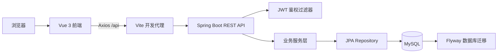
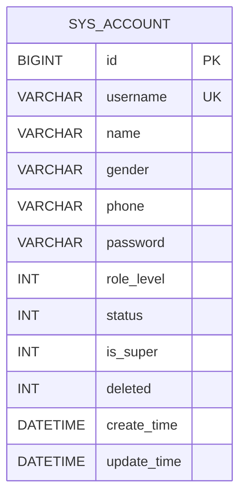
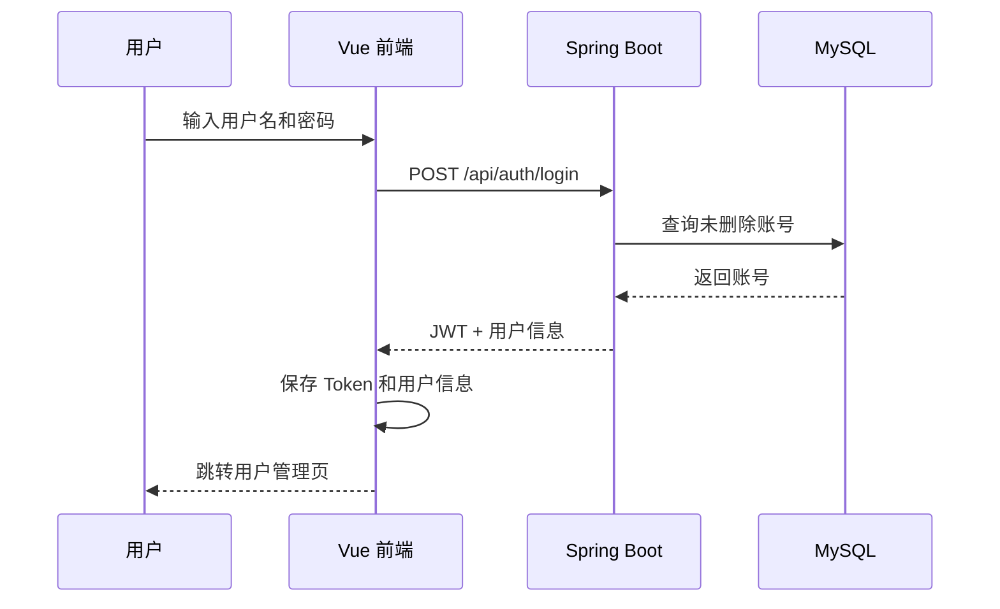

# 欣铁面试项目功能架构说明

## 1. 系统定位

本项目是一个前后端分离的简化版用户管理系统，当前核心目标是完成账号登录和用户账号生命周期管理。

当前已实现的业务闭环为：

```text
用户访问前端
    -> 登录认证
    -> 获取 JWT Token
    -> 携带 Token 访问用户管理
    -> 用户账号增删改查
    -> 退出登录
```

项目任务文档中还规划了部门管理、用户-部门关联，以及用户列表搜索分页功能，这些属于当前版本的后续扩展方向。

## 2. 总体架构



### 2.1 前端层

- **框架**：Vue 3、TypeScript、Vite。
- **组件库**：Element Plus。
- **路由**：Vue Router。
- **状态管理**：Pinia，保存登录 Token 和当前用户信息。
- **请求封装**：Axios 统一处理 `/api` 前缀、JWT 请求头、401 跳转登录和错误提示。
- **页面组成**：
  - `Login.vue`：登录页。
  - `MainLayout.vue`：登录后的主布局，包含侧边栏、顶部用户信息和退出登录。
  - `UserManagement.vue`：用户列表、添加、编辑、删除。

### 2.2 后端层

- **框架**：Spring Boot 4.0.6。
- **接口层**：`controller` 提供 REST API。
- **业务层**：`service` 和 `service/impl` 负责账号业务逻辑。
- **数据访问层**：Spring Data JPA `repository`。
- **领域模型**：`entity.Account` 映射账号表，`dto.AccountDTO` 用于接口数据传输。
- **认证组件**：
  - `JwtUtil`：生成、解析和校验 JWT。
  - `JwtAuthenticationFilter`：拦截非认证接口，校验 `Authorization: Bearer <token>`。
  - `MD5Util`：对登录和账号密码进行 MD5 摘要。
- **数据库演进**：Flyway 从 `src/main/resources/db/migration` 执行版本化 SQL。

### 2.3 数据层

当前只有一张业务表：

| 表 | 作用 |
|---|---|
| `sys_account` | 保存用户名、姓名、联系方式、密码、权限级别、启用状态和软删除状态 |

初始化迁移脚本会创建超级管理员：

```text
用户名：admin
密码：123456
```

## 3. 功能架构

### 3.1 认证与会话管理

#### 登录

1. 前端校验用户名和密码必填。
2. 调用 `POST /api/auth/login`。
3. 后端查询未删除账号，校验 MD5 密码和账号状态。
4. 登录成功后生成 JWT，Token 中包含用户 ID、用户名和权限级别。
5. 前端将 Token 保存到 `localStorage`，将用户信息保存到 Pinia 和 `currentUser`。
6. 登录成功后跳转到用户管理页，支持通过 `redirect` 参数返回原访问地址。

#### Token 校验

- 前端每次请求自动添加 `Authorization` 请求头。
- 后端过滤器对 `/api/auth/**` 之外的接口执行 JWT 校验。
- Token 缺失、过期或无效时返回 HTTP 401。
- 前端收到 401 后清除本地会话并跳转登录页。
- `GET /api/auth/validate` 可单独验证 Token，并返回 Token 中的用户摘要。

#### 退出登录

- 前端调用 `POST /api/auth/logout`。
- 后端返回退出成功结果。
- 前端清理 Token 和当前用户信息并返回登录页。
- 当前退出登录是客户端会话清理，服务端没有 Token 黑名单或撤销记录。

### 3.2 用户管理

用户管理页面提供账号的完整 CRUD 操作：

| 能力 | 前端行为 | 后端接口 |
|---|---|---|
| 用户列表 | 页面加载、点击刷新 | `GET /api/accounts` |
| 用户详情 | 当前页面已封装接口，未单独使用 | `GET /api/accounts/{id}` |
| 新增用户 | 弹窗填写账号信息并提交 | `POST /api/accounts` |
| 编辑用户 | 弹窗回填并更新账号信息 | `PUT /api/accounts/{id}` |
| 删除用户 | 二次确认后删除 | `DELETE /api/accounts/{id}` |

账号表单字段包括：

- 用户名、姓名、性别、联系方式。
- 密码：新增时为空则使用默认密码 `123456`，编辑时为空则保持原密码。
- 权限级别：用户、管理员、超级管理员。
- 状态：启用、禁用。

删除采用软删除：服务层将 `deleted` 设置为 `1`，查询和登录只处理 `deleted = 0` 的账号。

### 3.3 主框架与导航

- 根路径 `/` 重定向到 `/users`。
- `/users` 受前端 `requiresAuth` 路由元信息保护。
- 主布局提供：
  - 左侧“用户管理”菜单。
  - 顶部当前页面标题。
  - 当前用户名称。
  - 退出登录按钮。
- 当前菜单和页面均围绕用户管理展开，尚未接入部门管理菜单。

## 4. 接口架构

### 4.1 认证接口

| 方法 | 路径 | 是否需要 JWT | 说明 |
|---|---|---:|---|
| `POST` | `/api/auth/login` | 否 | 用户名密码登录，返回 Token 和用户信息 |
| `POST` | `/api/auth/logout` | 否 | 返回退出成功，实际会话由前端清理 |
| `GET` | `/api/auth/validate` | 否 | 校验请求中的 Bearer Token |

### 4.2 账号接口

| 方法 | 路径 | 是否需要 JWT | 说明 |
|---|---|---:|---|
| `GET` | `/api/accounts` | 是 | 获取所有未删除账号 |
| `GET` | `/api/accounts/{id}` | 是 | 获取指定账号 |
| `POST` | `/api/accounts` | 是 | 创建账号 |
| `PUT` | `/api/accounts/{id}` | 是 | 更新账号 |
| `DELETE` | `/api/accounts/{id}` | 是 | 软删除账号 |

当前接口直接返回 DTO 或集合，异常主要通过运行时异常和 HTTP 状态码表达，尚未统一封装全局响应结构。

## 5. 核心数据模型



关键状态字段：

| 字段 | 取值 | 含义 |
|---|---|---|
| `role_level` | 1 / 2 / 3 | 用户 / 管理员 / 超级管理员 |
| `status` | 0 / 1 | 禁用 / 启用 |
| `is_super` | 0 / 1 | 是否超级管理员 |
| `deleted` | 0 / 1 | 未删除 / 已软删除 |

## 6. 典型业务流程

### 6.1 登录访问流程



### 6.2 用户新增流程

```text
打开新增弹窗
    -> 前端表单校验
    -> POST /api/accounts
    -> 校验用户名唯一性
    -> 密码 MD5 摘要（空密码使用 123456）
    -> JPA 保存账号
    -> 刷新用户列表
```

## 7. 当前实现边界与注意事项

以下内容已经有字段或基础结构，但当前还没有完整落地：

1. **权限控制未闭环**：JWT 中包含 `roleLevel`，但后端过滤器只做身份校验，没有按角色限制新增、编辑、删除等操作；前端也没有根据角色隐藏操作按钮。
2. **部门管理未实现**：任务文档要求新增 `sys_department`、部门 CRUD、导航和页面，目前代码中没有对应模块。
3. **用户-部门关联未实现**：`sys_account` 尚无 `department_id` 字段、实体关联和前端部门选择。
4. **搜索和分页未实现**：当前用户列表一次性加载全部账号，没有条件筛选和分页接口。
5. **密码摘要算法较弱**：当前使用无盐 MD5，生产环境应改用 BCrypt、Argon2 等慢哈希算法。
6. **配置存在开发默认值**：数据库密码、JWT 密钥和默认管理员密码直接写在配置或迁移脚本中，部署环境应通过环境变量或密钥管理服务注入。
7. **CORS 较宽松**：当前允许所有来源，生产环境应限制到明确的前端域名。
8. **前端路由保护偏客户端**：路由只检查本地是否存在 Token，真正的安全边界仍应由后端鉴权和授权保证。

## 8. 后续功能演进建议

建议按以下顺序扩展：

1. **部门管理基础模块**：完成表结构、实体、Repository、Service、Controller、页面和导航。
2. **用户-部门关联**：为账号增加可选部门字段，并在列表、创建和编辑场景中展示。
3. **角色授权**：统一角色常量和权限校验，至少限制超级管理员相关操作。
4. **搜索分页**：使用 `Pageable` 实现后端分页，前端增加筛选条件和分页组件。
5. **统一异常与响应格式**：引入全局异常处理器，统一返回 `success/code/message/data`。
6. **安全加固**：替换 MD5、外置敏感配置、收紧 CORS，并补充登录失败和操作审计日志。

